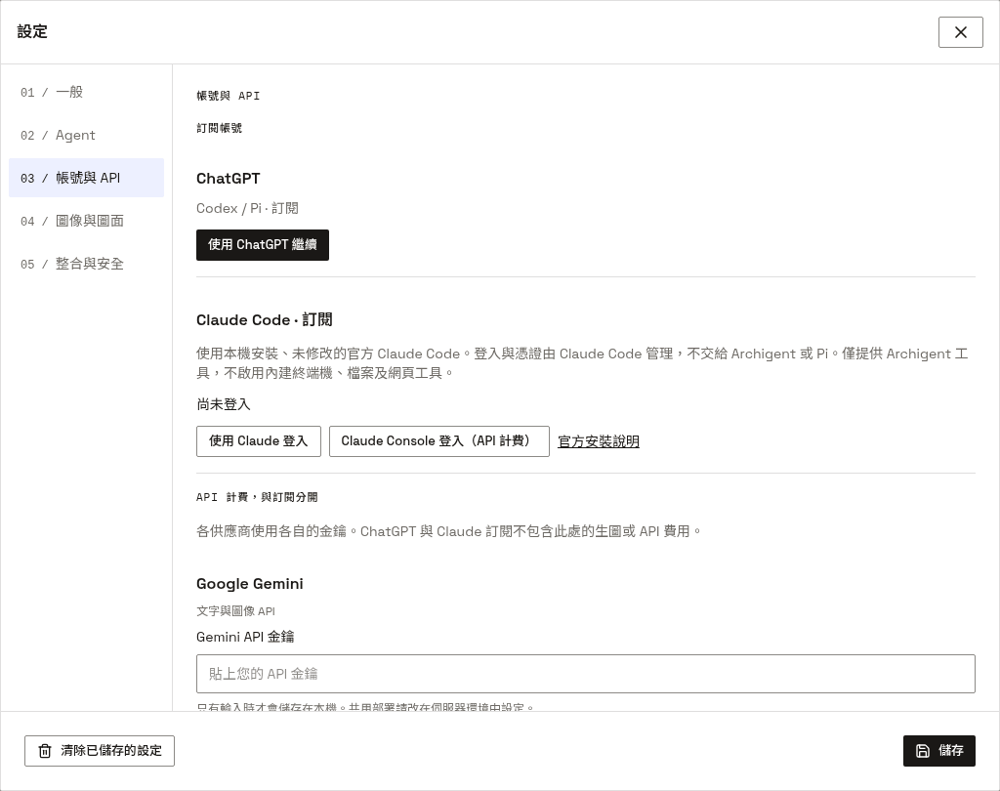
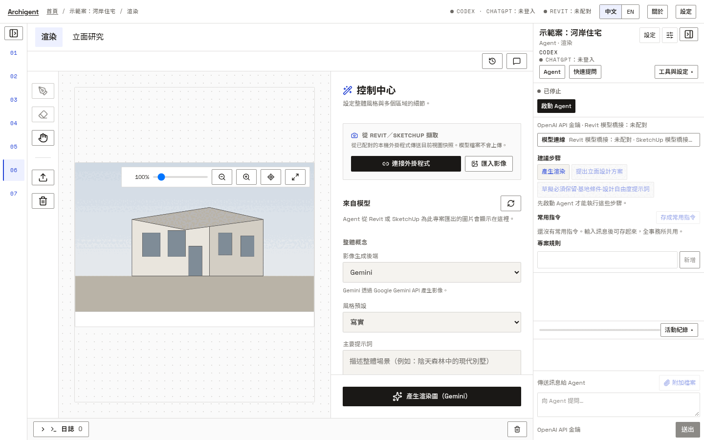
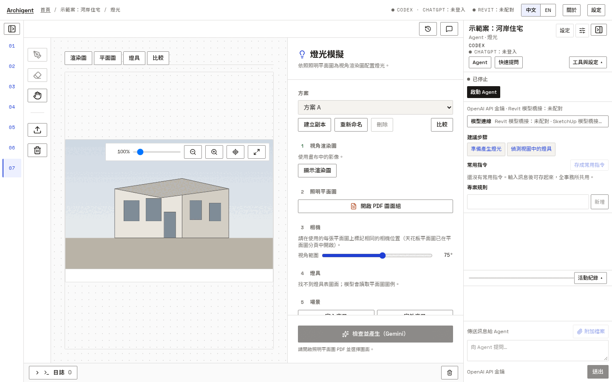

# Archigent 建築師使用指南

目錄

- [快速開始](#quick-start)
- [1. 首次啟動與服務設定](#section-1)
- [2. 建立專案與使用 Agent](#section-2)
- [3. 選擇 Agent 執行引擎：Codex、Claude Code 或 Pi](#section-3)
- [4. 核准、規則與專案設定](#section-4)
- [5. 獨立工具](#section-5)
- [6. ArchiLAW 與 Revit](#section-6)
- [7. 檔案位置與疑難排解](#section-7)

請在工作電腦上使用 Archigent。專案 Agent 的檔案與 Revit、CAD 檔案分開存放；獨立工具不需要建立專案。Agent 與影像工具可能使用付費服務，傳送前請確認內容。

截圖使用繁體中文介面與虛構的示範專案（示範案：河岸住宅），未設定任何金鑰。畫面可能因版本及作業系統略有不同；可用頁首的「中文／EN」切換語言。

*首頁：建立或開啟專案，或直接使用獨立工具*

## 快速開始

1. 安裝並開啟 Archigent（第 1 章）。
2. 在「設定 > 帳號與 API」登入 ChatGPT 或貼上 API 金鑰（第 1 章）。
3. 在「設定 > Agent」確認 Agent 執行引擎：預設為 Codex；Claude Code 與 Pi 的設定見第 3 章。
4. 在「首頁」建立專案並開啟一個階段（第 2 章）。
5. 選取「啟動 Agent」，選擇建議步驟或自行輸入請求，再按「送出」。
6. 核准前請詳讀每一張核准卡片（第 4 章）。

## 1. 首次啟動與服務設定

開啟桌面應用程式，或向管理員取得本機網頁位址。使用頁首語言切換鈕選擇英文或繁體中文。開啟「設定」，如有 ChatGPT Plus 或 Pro 帳號，選取「ChatGPT > 使用 ChatGPT 繼續」，在同一部電腦的系統瀏覽器完成登入，返回應用程式並確認登入狀態。需要時可在同一處登出。遠端或共用伺服器不提供此登入方式。

*設定 > 帳號與 API：訂閱登入及 API 金鑰*

在「設定 > Agent > 服務供應商選擇」分別選擇文字及 Agent 供應商。使用預設的 Codex 引擎時，Agent 可使用 ChatGPT 方案、OpenAI API 金鑰，或支援 Responses 的 OpenAI 相容服務；Claude Code 與 Pi 請見第 3 章。Gemini 與僅支援對話的相容服務可供文字功能使用。相容服務需填入基底網址、模型及金鑰；只有確實支援 Responses 時才勾選。使用「渲染」、「燈光」或「立面研究」時，仍須在設定中提供 Gemini 或 OpenAI API 金鑰；ChatGPT 方案不包含影像產生。桌面版會使用作業系統憑證服務儲存金鑰；若無法使用，請管理員設定伺服器環境。

*設定 > Agent：預設執行引擎與服務供應商*

### 安裝應用程式

請從[下載頁面](https://pimiya.github.io/aixgood/archigent/download.html)下載 Archigent，或直接到[最新發行版本](https://github.com/PIMIYA/aixgood/releases/latest)下載。每個發行版本都附有 `SHA256SUMS.txt`，可用來核對下載的檔案。

#### Windows

1. 從下載頁面下載 `Archigent-Setup-<版本>-x64.exe`。
2. 執行安裝程式並依照步驟完成安裝。Windows 安裝程式目前尚未程式碼簽章，SmartScreen 可能顯示「Windows 已保護您的電腦」。只有確認檔案來自下載頁面或專案團隊時，才選擇「其他資訊 > 仍要執行」。若公司政策封鎖安裝程式，請洽詢 IT 管理員。
3. 從開始功能表開啟 **Archigent**。
4. 選取頁首的「關於」，確認版本與發行頁面相同。

*關於：確認已安裝的版本*

#### macOS

請從下載頁面下載其中一個 ZIP：

- Apple Silicon Mac 使用 `Archigent-<版本>-arm64-mac.zip`。
- Apple Silicon 或 Intel Mac 使用 `Archigent-<版本>-universal-mac.zip`。

1. 連按兩下 ZIP，解壓縮 **Archigent.app**。
2. 將 **Archigent.app** 移至「應用程式」。
3. 開啟應用程式。此程式已由 Apple 簽章及公證；第一次開啟時，macOS 會詢問是否開啟從網路下載的應用程式，請選擇「打開」。
4. 選取頁首的「關於」，確認版本與發行頁面相同。

從 ArchiGen Studio 升級：軟體已改名為 Archigent。專案、設定與已儲存的金鑰都留在原處，會直接出現在 Archigent。Mac 安裝
**Archigent.app** 後，請結束舊程式，並從「應用程式」刪除 **ArchiGen Studio.app**。Windows 安裝程式會直接取代舊版。請從
軟體內重新安裝 SketchUp 與 Revit 外掛，外掛選單才會顯示 Archigent；重新安裝前，舊外掛仍可正常配對。

### 設定服務金鑰

1. 點選右上角的「設定」，選擇「帳號與 API」。
2. 在 **Google Gemini** 及／或 **OpenAI** 區塊貼上您自己的 API 金鑰。
3. 選取「儲存」。桌面應用程式會透過作業系統憑證服務保存金鑰；金鑰不會被包入應用程式，也不會再次顯示給您。
4. 重新開啟「設定」，確認金鑰顯示為已儲存。

#### 服務供應商與執行引擎一覽

Archigent 在三個地方使用 AI 服務：**文字功能**（助理、提示詞協助）、專案 **Agent**，以及**影像產生**（渲染、燈光、立面研究）。每項服務若不是**訂閱登入**（ChatGPT、Claude），就是由供應商依用量計費的 **API 金鑰**。Agent 可在三種執行引擎之一上執行（第 3 章）；下表列出各供應商可用的地方。

| 供應商 | 連接方式 | 文字功能 | Agent: Codex | Agent: Pi | Agent: Claude Code | 影像產生 |
| --- | --- | --- | --- | --- | --- | --- |
| ChatGPT Plus 或 Pro | 訂閱登入：帳號與 API > ChatGPT | 可 | 可 | 可 | 否 | 否 |
| Claude 個人訂閱（例如 Pro 或 Max） | 訂閱登入：帳號與 API > Claude Code >「使用 Claude 登入」 | 否 | 否 | 否 | 可（預覽） | 否 |
| Claude Console | API 計費：帳號與 API > Claude Code >「Claude Console 登入」 | 否 | 否 | 否 | 可（預覽） | 否 |
| OpenAI | API 金鑰：帳號與 API > OpenAI | 可 | 可 | 可 | 否 | 可 |
| Google Gemini | API 金鑰：帳號與 API > Google Gemini | 可 | 否 | 可 | 否 | 可 |
| Anthropic（Claude 模型） | API 金鑰：帳號與 API >「Pi 服務 API 金鑰」 | 否 | 否 | 可 | 否 | 否 |
| xAI (Grok) | API 金鑰：「Pi 服務 API 金鑰」 | 否 | 否 | 可 | 否 | 否 |
| Kimi (Moonshot) | API 金鑰：「Pi 服務 API 金鑰」 | 否 | 否 | 可 | 否 | 否 |
| OpenRouter | API 金鑰：「Pi 服務 API 金鑰」 | 否 | 否 | 可 | 否 | 否 |
| OpenAI 相容端點 | 基底網址、模型、選填金鑰：帳號與 API | 可 | 須支援 Responses API | 可 | 否 | 否 |

須知：

- **訂閱不包含影像與 API 費用。** ChatGPT 或 Claude 訂閱可以執行 Agent，但渲染、燈光與立面研究一定需要 Gemini 或 OpenAI API 金鑰。
- **Claude 訂閱只能透過 Claude Code 引擎使用。** 須自行安裝官方 Claude Code，再從 Archigent 登入；Archigent 不會看到您的 Claude 密碼或憑證。不接受 Claude Team 與 Enterprise 帳號；請改用 Claude Console（API 計費），或以 Pi 搭配 Anthropic 金鑰。Windows 目前不提供 Claude Code，此版本中 Claude Code 為預覽功能（第 3 章）。
- **Pi 搭配 API 金鑰**可使用 Anthropic（Claude 模型）、Google Gemini、xAI、Kimi、OpenRouter、OpenAI 或相容端點，由各供應商依用量計費。Anthropic、xAI、Kimi 與 OpenRouter 的金鑰輸入「Pi 服務 API 金鑰」（桌面版，以作業系統憑證服務保存）；Gemini 與 OpenAI 金鑰使用各自的欄位。在「設定 > Agent」選擇「Pi 供應商」與「Pi 模型」；清單只會列出已登入或已儲存金鑰的供應商。各供應商提供的模型：Anthropic claude-sonnet-4-5、claude-opus-4-6；Gemini gemini-3.1-pro-preview、gemini-2.5-flash；xAI grok-4.7；Kimi kimi-k3.1-pro；OpenRouter openai/gpt-5.6-terra、google/gemini-3.1-pro-preview；OpenAI gpt-5.6-terra、gpt-5.6-sol、gpt-6-sol；ChatGPT 方案 gpt-5.6-terra、gpt-5.6-sol。
- **Codex** 只接受 ChatGPT 方案、OpenAI 金鑰，或支援 Responses API 的相容端點。供應商清單中標示「— Pi」的選項須搭配 Pi 引擎。
- 目前不提供 GitHub Copilot。

#### 文字與 Agent 服務供應商

在「設定 > Agent」中，「預設執行引擎」可選擇 Codex（ChatGPT 方案或 OpenAI）、Pi（多家 API 供應商）或 Claude Code（透過本機安裝的官方 Claude Code 使用 Claude 訂閱）。在「服務供應商選擇」分別選擇文字功能與 Agent 的服務供應商。文字功能支援 ChatGPT 方案、OpenAI 金鑰、Gemini 金鑰與 OpenAI 相容端點。Agent 支援 ChatGPT 方案、OpenAI 金鑰，以及支援 Responses API 的相容端點。若要使用 ChatGPT 方案，請先在 ChatGPT 區塊登入。Gemini 與僅支援聊天的端點無法執行 Agent。使用相容端點時，請輸入基底網址與模型，並可選擇輸入 API 金鑰。金鑰欄只會顯示「金鑰已儲存」，不會顯示金鑰內容；可選擇「取代」或「清除金鑰」後儲存。網址須使用 HTTPS，只有 `127.0.0.1` 等明確的本機迴圈位址可使用 HTTP。影像生成仍使用下方的 Gemini 或 OpenAI 設定。

#### Gemini 模型

開啟「設定」時，系統會從您的 Gemini 帳戶取得「圖像與圖面」中的影像模型清單。選取「重新整理模型」 可重新取得最新可用模型。備援清單不代表該模型已對您的帳戶、地區或 API 金鑰啟用。

## 2. 建立專案與使用 Agent

### 建立與開啟專案

1. 在「首頁」的「專案名稱」輸入名稱，選取「建立專案」。既有專案列在下方，選取即可開啟。
2. 專案會從第一個階段開啟。左欄列出七個階段（手稿、CAD、模型、圖紙、數量造價、渲染、燈光）；階段狀態僅供參考，隨時可以開啟任何階段。
3. 中央顯示該階段的檔案或工具；右欄是「Agent 面板」，有「Agent」與「快速提問」兩個分頁。

*專案畫面：左側為階段，中央為目前階段，右側為 Agent 面板*

### 使用 Agent

1. 查看 Agent 面板上方顯示的引擎與帳號（例如 `CODEX · CHATGPT：已登入`）。要改用其他引擎，請見第 3 章。
2. 選取「啟動 Agent」。第一次使用時會下載並驗證執行引擎，請等待進度顯示。
3. 選取「建議步驟」把請求帶入訊息框，或自行輸入；建議步驟不會自動送出。確認內容後按「送出」。
4. 檢視計畫與「活動紀錄」。需要您決定時，面板會出現核准卡片或提問（見第 4 章）。
5. 「中斷」可停止本輪；「停止」會結束 Agent 工作階段。閒置 15 分鐘後 Agent 也會自動停止。

每一輪 Agent 都會取得目前階段的指引、專案規則與專案設定。

### Agent 控制

選取 Agent 面板上方的調整按鈕（「Agent 控制」）即可顯示：

- 「Agent 執行引擎」：此專案使用的引擎（在設定中變更，見第 3 章）。
- 「模型」與「思考強度」：Agent 啟動後可選。相容端點的模型固定。
- 「自動模式」：「每次都問」（預設）；「自動：低風險」會自動核准建立與修改 Agent 自己建立的 Revit、SketchUp 元素；「自動：完整」再加上匯出與專案規則。自訂 C# 或 Ruby、ArchiLAW 查詢、付費出圖、刪除，以及 Codex 在沙箱外的指令一定會詢問。每輪最多自動核准 20 次，每次都會在活動紀錄顯示「自動核准」。
- 「先計畫」：Agent 先提出計畫、不做任何變更，按「依計畫執行」才開始。
- 「對話」：此引擎之前的對話（啟動時會接續最近一次）與「＋ 新對話」。以較舊工具建立的對話會提示您開始新對話。

### 附加檔案、常用指令與通知

- 「附加檔案」（或把檔案拖到訊息框）可把 PNG、JPEG 或 PDF 加入專案資料夾，每個檔案 15 MB 以內、每則訊息最多 10 個。只有專案開放未遮罩傳送時，圖片才會傳給模型，且每次都會記錄；PDF 只以檔名提供。
- 「常用指令」全事務所共用：輸入訊息後按「存成常用指令」，點選即可帶入。
- 「設定 > 一般 > 通知」可在 Archigent 不在前景時，於 Agent 完成或需要核准時顯示桌面通知，通知不含訊息內容。

*Agent 面板展開「Agent 控制」：引擎、模型、思考強度、自動模式、對話、先計畫與專案規則*

### 調整工作區

若需要更大的中央工作區，可用「階段」旁的按鈕收合階段列，用 Agent 面板右上角的按鈕收合 Agent 面板。收合後的階段列仍保留各階段的編號連結。收合時 Agent 會繼續工作；需要你核准時，收合列會顯示等你核准的數量並跳出提醒。拖曳 Agent 面板左側邊緣可調整寬度（在邊緣按兩下恢復預設）。這些設定都會記住。「設定 > 一般 > 外觀」可選擇「跟隨系統」、「淺色」或「深色」。

### 各階段可請 Agent 處理的事項

| Stage | 可請 Agent 處理及應檢查的事項 |
| --- | --- |
| 手稿 | 整理版本、找出缺少的尺寸，依已知基地尺寸校正；確認假設與採用的手稿。 |
| CAD | 建立毫米尺寸的圖層與標註，匯出 DWG／DXF 及 PDF，與手稿疊合；檢查推估尺寸與圖層名稱。 |
| 模型 | 讀取配對的 Revit 或 SketchUp 模型、報告建築師新增的修改、提出版本化變更；核對版本及受影響元素後逐項核准寫入。SketchUp 的一批變更是一個復原步驟，任何失敗都會整批復原。 |
| 圖紙 | 列出所需圖紙，逐張匯出並檢查文字重疊、超出圖框及簡體字；檢查標題欄與圖號。 |
| 數量造價 | 要求附來源的數量、獨立重算及差異報告；檢查單價來源與標示的 AI 估價。 |
| 渲染 | 說明必須保留的部分、基地條件與設計自由度；比較生成視圖及對位分數。 |
| 燈光 | 讀取圖紙與燈具表、確認位置及可修改區域、比較方案。 |

手稿、CAD、模型及數量造價目前提供階段指引，尚無專用編輯面板。Agent 可在專案工作目錄處理檔案；Revit 與 SketchUp 操作需要在「模型」階段配對外掛，並經明確核准。CAD 匯出與造價結論仍須由建築師檢查。

## 3. 選擇 Agent 執行引擎：Codex、Claude Code 或 Pi

專案 Agent 可使用三種執行引擎之一。三者都使用相同的 Archigent 工具（專案檔案、手稿與 CAD 工具、ArchiLAW、Revit 與 SketchUp）、同一套核准卡片及專案規則；差別在於可使用的帳號、安裝方式與保護方式。

|  | 預設) | Claude Code | Pi |
| --- | --- | --- | --- |
| 可用帳號 | ChatGPT 方案、OpenAI API 金鑰、支援 Responses API 的 OpenAI 相容端點 | 個人 Claude 訂閱，或 Claude Console（API 計費） | ChatGPT 方案、OpenAI、Anthropic（Claude 模型，API 計費）、Google Gemini、xAI、Kimi、OpenRouter、相容端點 |
| 安裝 | 首次啟動時自動下載並驗證 | 須自行安裝官方 Claude Code（2.1 版中的 2.1.319 以上） | 首次使用時自動下載並驗證（約 25 MB） |
| 工具 | Archigent 工具，另有在沙箱內執行的指令與檔案修改，每次都須核准 | 只有 Archigent 工具，內建終端機、檔案及網頁工具均關閉 | 只有 Archigent 工具 |
| 保護 | 作業系統沙箱，指令不可連網 | 限制工具範圍，沒有作業系統沙箱 | 在與 Codex 相同的沙箱內執行 |
| macOS | 可用 | 預覽 | 可用 |
| Windows | 可用；完成一次性安全設定後才有完整保護 | 尚未開放 | 完成一次性安全設定後才可用 |
| 模型 | 啟動後依帳號列出 | sonnet（預設）、opus、fable | 依供應商的固定清單，在設定中選擇 |

選擇建議：有 ChatGPT Plus 或 Pro 方案、或 OpenAI 金鑰時，先使用 **Codex**。有個人 Claude 訂閱且在 Mac 上工作時，使用 **Claude Code**（目前為預覽，見下文）。要使用 Anthropic、Gemini、xAI、Kimi 或 OpenRouter 的 API 金鑰時，使用 **Pi**。Claude 訂閱只能透過 Claude Code 使用；Pi 搭配 Anthropic 是依 API 用量計費。目前不提供 GitHub Copilot。

### 切換引擎

*設定 > Agent：預設執行引擎、目前專案的引擎，以及 Pi 供應商與模型*

引擎有兩個層級。「預設執行引擎」適用於所有沒有另外指定的專案；「目前專案」（只在開啟專案時顯示）只改變該專案。

1. 只想改變某個專案時，先開啟該專案；再選取頁首的「設定」，選擇「Agent」。
2. 在「Agent 執行引擎」選擇「預設執行引擎」或「目前專案」。選擇「使用 App 預設值」可取消專案自己的設定。
3. 選擇後會立即儲存，不需要按「儲存」，並在下次啟動 Agent 時生效。
4. 要變更「目前專案」，請先在該專案的 Agent 面板按「停止」；Agent 執行中時此選項會鎖定。預設執行引擎隨時可以變更；執行中的 Agent 會繼續使用原本的引擎，直到停止為止。
5. 變更專案的引擎時，該專案的「模型」與「思考強度」會恢復預設值。
6. 選取「啟動 Agent」，並查看 Agent 面板上方顯示的引擎名稱（例如 `CODEX · CHATGPT：已登入`、`CLAUDE CODE · 訂閱已連線` 或 `PI · ANTHROPIC API 金鑰 · CLAUDE-SONNET-4-5`）。

無法在這部電腦執行的引擎仍會列出，但不能選取：Claude Code 在安裝並登入前會顯示「需要設定」；這部電腦無法執行 Pi 時會顯示「此裝置尚未支援」。

### 切換後的對話

每個引擎的對話分開保存。切換引擎不會轉換或刪除對話：切回 Codex 時，之前用 Codex 的對話會再出現。啟動 Agent 時會接續該引擎最近一次的對話；要重新開始，請在「Agent 控制」選擇「＋ 新對話」。閒置 15 分鐘後 Agent 會自動停止，再次啟動即可接續。

### 設定 Codex

1. 開啟「設定 > 帳號與 API」。使用 ChatGPT 方案時，在「ChatGPT」選取「使用 ChatGPT 繼續」，在這部電腦的瀏覽器完成登入後回到 Archigent；使用 OpenAI 金鑰時，貼到「OpenAI」欄位。
2. 在「設定 > Agent」把「Codex／Pi 服務供應商」設為「使用您的 ChatGPT 方案」、「OpenAI API 金鑰」或「OpenAI 相容端點」。只有在「帳號與 API」勾選「支援 Responses API」後，才能選擇相容端點。
3. 選取「啟動 Agent」。第一次啟動會下載並驗證 Codex（先顯示「正在下載 Agent 執行引擎」，再顯示「正在驗證 Agent 執行引擎」）。

若面板顯示「請到設定登入 ChatGPT，才能使用此 Agent 服務」，請按「開啟設定」登入。供應商清單中標示「— Pi」的 Anthropic、Gemini、xAI、Kimi 與 OpenRouter 只能搭配 Pi 引擎；使用 Codex 時 Agent 無法啟動。

### 設定 Claude Code

Claude Code 在此版本為預覽功能：在已安裝的桌面版中登入後實際使用的情況尚未完整驗證。若無法正常運作，請把專案改回 Codex，並附上操作步驟回報問題。

*設定 > 帳號與 API：尚未安裝時的 Claude Code 區塊*

1. 在這部電腦安裝官方 Claude Code（「官方安裝說明」會開啟 Anthropic 的安裝頁面）。Archigent 不會安裝或修改它。需要 2.1 版中的 2.1.319 以上；版本太舊時會顯示「請更新官方 Claude Code」。
2. 在「設定 > 帳號與 API」的「Claude Code · 訂閱」區塊，使用訂閱時選取「使用 Claude 登入」，使用 API 計費時選取「Claude Console 登入（API 計費）」。在瀏覽器完成官方登入後回到 Archigent，區塊會顯示「訂閱已連線」或「Claude Console 已連線，使用 API 計費而非訂閱」。Archigent 使用自己的 Claude Code 設定資料夾；即使已在終端機使用 Claude Code，仍請在這裡登入。
3. 在「設定 > Agent」把預設執行引擎或目前專案設為「Claude Code · 訂閱」，再啟動 Agent。啟動後可選擇模型（sonnet、opus 或 fable）與思考強度。

登入與憑證由 Claude Code 保管，Archigent 不會讀取。登入、登出或在訂閱與 API 計費之間切換前，請先停止所有使用 Claude Code 的 Agent。若公司以原則管理 Claude Code，為保護專案，此引擎會停用（「偵測到受管理的 Claude 原則」）。Windows 目前不提供 Claude Code；在 Windows 上仍可透過 Pi 搭配 Anthropic API 金鑰使用 Claude 模型。

### 設定 Pi

1. 先準備 Pi 要使用的帳號。ChatGPT 方案：在「設定 > 帳號與 API > ChatGPT」登入。OpenAI 或 Gemini：貼到原有的金鑰欄位。Anthropic、xAI、Kimi 或 OpenRouter：在桌面版的「Pi 服務 API 金鑰」輸入金鑰，金鑰會以作業系統憑證服務保存。
2. 在「設定 > Agent」把預設執行引擎或目前專案設為「Pi · 多家供應商」。
3. 選擇「Pi 供應商」與「Pi 模型」。清單只會列出已登入或已儲存金鑰的供應商。「使用已設定的 Agent 供應商」會沿用「Codex／Pi 服務供應商」的設定；「使用供應商預設模型」會採用該供應商的第一個模型。這兩項設定適用於所有專案，並在下次啟動 Agent 時使用。
4. 選取「啟動 Agent」。第一次使用會下載並驗證 Pi（約 25 MB）。只有支援的模型才會提供思考強度（低、中、高）。

在 Windows 上，完成一次性安全設定後才能使用 Pi（見下方「Windows 注意事項」）。若 Agent 無法啟動，請確認所選的 Pi 供應商顯示「已設定 API 金鑰」，或改選其他供應商。

### Windows 注意事項

在 Windows 上，完成一次性安全設定，或在「Windows Agent 的保護有限」卡片選擇「我瞭解風險，繼續使用」後，即可使用 Codex。要取得完整保護，請開啟「設定 > 整合與安全」，選取「設定或修復安全保護」並同意系統管理員提示。驗證完成後即可使用完整沙箱及 Pi；這部電腦一次只能執行一個專案的 Agent。Windows 目前不提供 Claude Code。

### 引擎疑難排解

| 狀況 | 處理方式 |
| --- | --- |
| 引擎選項無法選取 | Claude Code：安裝、登入並確認版本。Windows 上的 Pi：完成安全設定。 |
| 「無法儲存引擎選擇」 | 先停止此專案的 Agent，再重新選擇。 |
| 選擇 Anthropic、Gemini、xAI、Kimi 或 OpenRouter 後 Agent 無法啟動 | 這些供應商只能搭配 Pi，請把引擎改為 Pi。 |
| Claude Code 顯示「尚未登入」或「需要個人的 Claude 訂閱登入」 | 在「帳號與 API」用個人訂閱重新登入，或改用 Claude Console（API 計費）。 |
| 模型清單是空的 | 啟動 Agent 後才會列出模型。 |
| 舊對話顯示工具較舊的提醒 | 開始新對話，即可使用之後新增的工具。 |

## 4. 核准、規則與專案設定

核准卡片會顯示建議的指令、檔案變更、對外查詢或模型操作。檢查完整參數及受影響檔案，再選擇「核准」或「拒絕」；內容不清楚時，先拒絕並要求縮小範圍。ArchiLAW 查詢會顯示查詢文字或文件識別碼。執行 Revit 程式碼前應看到完整 C# 原始碼與雜湊值。單次卡片不能核准廣泛權限。不要核准將客戶姓名、聯絡資訊或案件細節傳給外部服務。

在「專案規則」新增、修改或移除簡短指示；修改既有規則後請儲存。Agent 建議的新規則也需要核准才會保存。Agent 面板上方、專案名稱旁的「設定」按鈕開啟「專案設定」，可設定選用的設計標準、族群資料庫路徑及標題欄範圍。標題欄以圖紙百分比表示。圖紙預設遮罩；「傳送未遮罩圖紙」是個別專案設定，變更及每次傳送都會留下紀錄。即使啟用此選項，每次仍要檢查即將傳送的頁面。

*專案設定（Agent 面板上方的「設定」按鈕）*

## 5. 獨立工具

### 產生影像

1. 從首頁開啟「渲染」，或選擇專案的「渲染」階段，再上傳一張基礎影像。
2. 輸入整體建築設計提示詞。
3. 視需要新增區域，只塗繪要編輯的範圍，並為各區域輸入具體指示。
4. 選擇 Gemini 或 OpenAI 作為服務供應商。
5. 選取「產生渲染圖（Gemini）」或「產生渲染圖（OpenAI）」。
6. 檢查結果。只有在要以結果取代目前畫布影像時，才使用「設為基底影像」。

*渲染：畫布載入基礎影像；「從 Revit／SketchUp 擷取」位於控制中心*

### 立面研究

1. 從首頁開啟**立面研究**。若在專案中，請開啟**渲染**階段，再選擇**立面研究**分頁。
2. 加入一張現有建築視角，以及 2 至 5 張參考案例圖片。圖片須為 PNG、JPEG 或 WebP，每張不超過 20 MiB、單邊不超過 8192 像素，總大小不超過 35 MiB。
3. 視需要輸入基地條件與設計標準，選擇 Gemini 或 OpenAI，並指定 1 至 3 個方案。
4. 選擇**檢查後送出**，核對實際要傳送的圖片與指令。Gemini 使用所有參考圖；OpenAI 只使用前兩張，畫面會說明略過的張數。按下**送出**後，才會使用服務金鑰開始產生影像。
5. 將每個結果與建築原始視角比較。分數達 0.35 的結果會標示為**有效方案**。分數達 0.25 但未達 0.35 的結果會標示為**請確認量體**；請檢查相機位置、量體、樓層與開口，再按下**我確認量體，可供使用與儲存**，才能儲存或選擇**作為渲染工具的基礎影像**。確認後仍保留警示標示。分數低於 0.25 的結果會標示為**量體已變更**，不可使用或儲存。在專案內，有效方案會自動儲存至本機時間軸；標示「請確認量體」的結果，須經您確認後才會儲存。

*立面研究：已選擇現有建築視角與兩張參考圖*

### 燈光模擬

1. 從首頁開啟 **獨立工具 > 燈光**，或在專案工作台選擇 **燈光**，再將視點渲染圖載入畫布。
2. 開啟圖說 PDF。選擇天花照明配置平面圖；若空間有立燈或壁燈，再選擇地坪照明配置平面圖。
3. 在「平面圖」分頁中，對每一張圖：拖曳框出渲染圖所看到的範圍，不要包含圖框與圖例，選取「確認裁切範圍」；再切換到「相機」，點一下相機位置並拖曳到視線方向。兩張圖請標在同一個位置。
4. 可選擇匯入燈具表。若燈具表跨多張圖，請逐張匯入，資料會依燈具編號合併。燈具表只在這台電腦上讀取。請確認廠牌與型號欄位；「查詢」會在您確認要送出的廠牌與型號後上網查詢缺少的資料，並保存供之後的專案使用。
5. 選擇場景，並視需要輸入補充說明。
6. 選取「檢查並產生（Gemini）」。確認圖片與指令文字後選取「傳送至 Gemini」；在此之前不會送出任何內容。

*燈光模擬：方案與從視角渲染圖到場景的六個步驟*

預設情況下，結果會保留渲染圖的結構，並從 AI 影像轉移燈光（「設定 > 圖像與圖面 > 燈光 > 輸出：燈光轉移」）。若模型把空間改動到無法與渲染圖對齊，結果會被退回，您的渲染圖不會改變，請重新產生。另一個選項「AI 影像」會直接顯示模型產生的影像，並在空間被改動時提出警告。

比較燈光方案：
1. 確認裁切範圍並設定好相機方向後，視角內的燈具會自動放到平面圖上。面板會顯示數量；無法判斷燈具規格變體的標籤會另外計數，請自行加入。
2. 在「平面圖」分頁選擇「燈具」，即可移動、新增（先選擇燈具編號）、停用或刪除標記。在您編輯任何標記之前，改變視角時自動標記會跟著更新。
3. 使用方案控制項中的「建立副本」嘗試另一種配置，再分別產生各方案。「比較」分頁會並排顯示每個方案的最新結果。

只修改某個區域的燈光：在結果上選取「設為基底影像」，在「渲染圖」分頁塗繪區域，於「區域編輯」步驟寫下要修改的內容，再使用 Gemini 產生。只有塗繪的區域會改變；OpenAI 燈光區域編輯會在傳送前被拒絕。若要讓 AI 在塗繪區域畫出燈具本體（例如軌道投射燈），請開啟「設定 > 圖像與圖面 > 燈光 > 在繪製區域中顯示燈具本體」，並將該區域設為「燈具本體」。

燈具資料庫：在「燈具」分頁選擇「燈具資料庫」，可依廠牌、型號或類型搜尋，手動新增或編輯燈具，上網查詢，或用「新增至專案」指定給某個燈具編號。

結果是視覺模擬，不是照明計算，沒有照度數值。照度計算請使用 DIALux 或 Relux。渲染圖中原有的日光（陽光照射的光斑）在轉換成夜間燈光後仍會淡淡可見；使用沒有直射陽光的渲染圖效果最好。

### 請 Agent 渲染或檢查專案檔案

若檔案已在專案工作目錄，可請 Agent 渲染 PNG／JPEG 視圖、以 2–5 張參考圖產生 1–3 個立面方案，
或在本機檢查 PDF 圖紙。影像工具預設使用 Gemini，也可指定 OpenAI；OpenAI 立面研究僅接受兩張
參考圖。Agent 影像工具使用伺服器或桌面版設定的金鑰，不使用僅儲存在瀏覽器的個人金鑰。

核准前，請檢查每張圖片預覽、路徑與尺寸、完整指示、供應商／模型及付費輸出數量。這些工具會依
預覽原樣傳送視圖，不會遮蔽標題欄；若視圖包含私人圖面資訊，請拒絕。渲染及立面工具不接受 PDF。
審核期間若來源檔案改變，請重新要求審核。拒絕後不會呼叫供應商，也不會儲存結果。

結果會存入 `renders/` 或 `facade/`，並附上對齊分數。0.35 以上為 `valid`；0.25 至未滿 0.35 為
`check`，表示應檢查量體；低於 0.25 為 `changed`，表示量體已改變，儲存檔名也會加上
`massing-changed`。使用前請檢查建築幾何。燈光不是 Agent 工具；請在燈光介面裁切平面圖，並於圖上
繪製相機位置與方向。

Agent 的 `sheet_check` 會在本機檢查 PDF 的簡體字、文字重疊及超出偵測圖框的文字，不提供 AI
視覺檢查，也不會自動完成階段。沒有文字層或偵測圖框的頁面，請在圖紙檢查介面人工確認。

### 檢查圖紙

「圖紙檢查」：匯入 PDF、PNG 或 JPG 圖紙。PDF 的文字檢查在本機進行，包括簡體字、文字重疊及超出自動偵測或手動畫定圖框的文字。純影像頁面沒有本機文字檢查。結果可匯出為 Markdown 或 CSV。選用視覺檢查時，先框選標題欄，選取「傳送前檢視」，逐頁確認遮罩影像及指示，最後再確認傳送。專案若啟用未遮罩傳送，請先檢查會暴露的內容。圖紙檢查不會自動將階段標示完成。

*圖紙檢查載入範例 PDF：頁面、圖框工具與檢查結果*

## 6. ArchiLAW 與 Revit

查詢法規時，在「設定 > 整合與安全 > ArchiLAW」填入管理員提供的 HTTPS MCP 網址，儲存後選取「連線」，並在這部電腦使用自己的受邀帳號登入。狀態顯示已連線後，重新啟動 Agent 再提問。核准前檢查完整查詢文字、選填的管轄範圍或文件識別碼，移除個人及案件資訊；收到答案後檢查引用來源。「中斷連線」會移除本機憑證，儲存空白網址可停用服務。

*設定 > 整合與安全：ArchiLAW 連線*

若要取得視圖影像，先安裝對應的 Revit 或 SketchUp 擴充功能，在「從 Revit／SketchUp 擷取 > 連接擴充功能」取得本機端點與暫時權杖，輸入擴充功能後於主機程式擷取目前視圖。回到 Archigent 檢查縮圖，選擇「用於畫布」或「捨棄」；擷取不會自動取代畫布。截圖不要包含配對權杖。Agent 的 Revit 模型配對與視圖擷取是不同流程；管理員須安裝 Revit 2025／2026 增益集並配對所選專案。Revit 寫入前會儲存版本，並以紀錄追蹤 Agent 建立的元素；再次寫入前須報告建築師的修改。此橋接功能尚未在 Windows 的 Revit 中實測。

*模型階段：尚未配對的 Revit 與 SketchUp 模型橋接。配對後此處會顯示端點與權杖，截圖時請勿包含。*

### 擷取 Revit 或 SketchUp 視圖

此為選用流程，可將目前主機應用程式視圖的點陣快照傳送至 Archigent。Archigent 不會上傳、開啟或儲存 RVT／SKP 模型檔案。

1. 開始此流程前，請先安裝對應的擴充功能；Archigent 無法自動探索 Revit 或 SketchUp，也無法直接擷取其他應用程式視窗。SketchUp（macOS／Windows）：以 **Extensions → Extension Manager → Install Extension** 安裝 `ArchiGen-SketchUp-<版本>.rbz`。Revit 2025／2026（Windows）：解壓縮 `ArchiGen-Revit<年份>-<版本>.zip` 並執行 `install.ps1`。桌面版已內附安裝檔，可從此面板或「模型」階段的「安裝外掛」連結下載。
2. 在「控制中心」的「從 Revit／SketchUp 擷取」區塊，選取「連接外掛程式」。
3. 將面板顯示的位址與配對碼貼到擴充功能（逐項按「複製」，或按「兩者一起複製」後在 Revit 按「從剪貼簿貼上」）。請勿在螢幕截圖或支援請求中包含這些值。
4. 在 SketchUp 中使用 **Extensions → Archigent → Capture current view to Archigent**。在 Windows 的 Revit 中，從已安裝的增益集執行 **Capture current view to Archigent**。
5. 回到 Archigent，檢查縮圖、來源應用程式、文件顯示名稱與尺寸。
6. 選取「在畫布中使用」以取代目前基礎影像，或選取垃圾桶按鈕「捨棄」接收的快照。接收的快照不會自動取代畫布。

#### 支援平台與備援方式

- SketchUp 擴充功能適用於 macOS 與 Windows。Revit 增益集僅支援 Windows，因為 Revit 僅支援 Windows。
- 配對僅限同一台電腦，且只接受 PNG／JPEG 快照。新的配對碼須在五分鐘內使用；第一次擷取後，會在最後一次擷取後 12 小時內持續有效。重新啟動 Archigent 後本機位址會改變，請重新連接。
- 若擴充功能無法使用、配對已過期，或主機版本不受支援，請在 Revit 或 SketchUp 匯出目前視圖為 PNG／JPEG，再使用 Archigent 的「匯入影像」按鈕。
- 測試者的安裝說明位於 `integrations/README.md`。

### 對話與文件

「助理」（渲染與燈光工作區的對話泡泡圖示）用於快速詢問設計問題、討論提示詞，只回答、不會修改任何東西；它會參考目前的主提示詞、已核准的專案記憶與上傳的相關參考文件，不需要專案、ChatGPT 登入或 Revit，可用 Gemini 或 OpenAI（設定 > 文字服務）。回答中有建議的提示詞時，按「套用到提示詞」即可帶入畫布的提示詞欄。在專案中以 Agent 為主要助手：它也能查詢同樣的參考文件與已核准記憶，並在你核准後執行操作。Agent 面板的「快速提問」分頁開啟同一個輕量助理。專案、對話紀錄與記憶會儲存在本機資料庫。

## 7. 檔案位置與疑難排解

桌面版會在作業系統的使用者資料目錄保存私人資料；本機網頁伺服器預設使用 `~/.archigen-studio`，也可由 `ARCHIGEN_DATA_DIR` 指定。專案、對話與文件存於 `archigen.sqlite`；Agent 工作檔案位於 `projects/<id>/workspace/`，規則與設定則按專案保存。瀏覽器畫布歷程及部分網頁設定留在該瀏覽器。匯出的影像、Markdown／CSV 結果及 CAD／Revit 檔案會保存到您選擇或主機程式指定的位置；Agent 工作目錄的檔案不會自動複製到 Revit 或 CAD。請另行備份原始圖紙。

若「啟動 Agent」失敗，檢查 Agent 供應商與登入狀態，再查看下載或錯誤訊息；首次下載需要網路。若無法產生影像，檢查 Gemini／OpenAI 金鑰、模型及設定狀態；只有 ChatGPT 登入仍不足。若圖紙視覺檢查不能傳送，請框選標題欄並檢查遮罩頁面，或在該專案明確啟用未遮罩傳送並確認內容。若 Revit 配對失敗，確認 Archigent 與 Revit 在同一部電腦，於五分鐘權杖期限內重新配對，並使用對應年份的增益集。ArchiLAW 失敗時，檢查 HTTPS 網址、登入狀態與核准內容；變更帳號後重新連線並啟動 Agent。回報錯誤時，截圖不要包含憑證、配對權杖、客戶姓名或私人圖紙。

### 疑難排解

| 問題 | 處理方式 |
| --- | --- |
| Gemini 模型清單顯示備援內容 | 確認金鑰已儲存，在「設定 > 圖像與圖面」選取「重新整理模型」，再檢查 API 金鑰、帳戶、地區與網路是否可存取 Gemini。 |
| 出現 `401` 或 `403` 服務錯誤 | 金鑰無效、無法使用或權限不足。請在「設定 > 帳號與 API」重新輸入金鑰。 |
| 出現 `429` 服務錯誤 | 已達服務供應商的配額或速率限制。請稍後再試、改用其他可用模型，或檢查供應商帳戶。 |
| 影像結果不如預期 | 使用單一明確場景描述重試，減少參考影像，並只在需要編輯處塗繪遮罩。 |
| 更新後無法產生影像 | 完全結束應用程式後重新開啟，並在「設定 > 帳號與 API」確認已儲存金鑰。 |
| 未收到擴充功能快照 | 確認 Archigent 與主機應用程式在同一台電腦上執行，重新配對，並將目前本機端點與權杖複製到主機擴充功能。 |
| 擴充功能快照遭拒絕 | 配對可能已過期、影像可能過大，或請求不是 PNG／JPEG 快照。請重新配對，或改用手動 PNG／JPEG 匯入。 |

### 回報問題給開發團隊

測試期間遇到問題時，請直接在 Archigent 裡回報，開發團隊收到後會依回報內容修正：

1. 開啟頁首的「設定」，選取「整合與安全」分類，最上方就是「回報問題」。
2. 寫下發生了什麼、你做了哪些步驟，以及原本預期看到什麼。例如：「在草圖階段按『開始』後，Agent 一直沒有回應。」
3. 選取「預覽」，檢查將送出的內容。
4. 確認無誤後選取「送出」。畫面會顯示回報編號；之後要補充說明時，請附上這個編號。

![回報問題：預覽中的電話號碼已遮蔽為 [phone]](/aixgood/archigent/images/16-report-problem.png)

*回報問題：預覽中的電話號碼已遮蔽為 [phone]*

回報只包含你寫的描述，以及 Archigent 與外掛程式的版本、作業系統、目前所在的畫面（例如「草圖」階段，不含專案名稱），和近期紀錄的類別與時間。不會附上圖面、專案內容、Agent 對話或金鑰。電話、Email、身分證號、檔案路徑與金鑰會自動遮蔽，但系統無法辨識姓名，請不要寫業主或其他人的姓名。

近期紀錄只會留在這次開啟的 Archigent 中，請在問題發生後、關閉程式前回報。如果無法連線到回報伺服器，請確認網路後再按一次「送出」；預覽保留 15 分鐘。

### 安全

- 請勿在螢幕截圖、對話訊息、問題回報或電子郵件中傳送 API 金鑰、視圖配對權杖或擷取的模型檔案路徑。
- 需要另外提供截圖時，截圖不要包含憑證、配對權杖、客戶姓名或私人圖紙。
