# Archigent architect guide

Contents

- [Quick start](#quick-start)
- [1. First start and providers](#section-1)
- [2. Create a project and use the Agent](#section-2)
- [3. Choose an Agent engine: Codex, Claude Code or Pi](#section-3)
- [4. Approvals, rules, and project settings](#section-4)
- [5. Standalone tools](#section-5)
- [6. ArchiLAW and Revit](#section-6)
- [7. Files and troubleshooting](#section-7)

Use Archigent on the computer where you work. Projects keep the Agent's files separate from Revit and CAD files. Standalone tools can be used without a project. The Agent and image tools may use paid provider services; review what will be sent.

Screenshots show the Traditional Chinese interface with a fictional sample project (示範案：河岸住宅) and no keys. Your screen may differ slightly by version and operating system; use the header 中文 / EN switch to change the language.

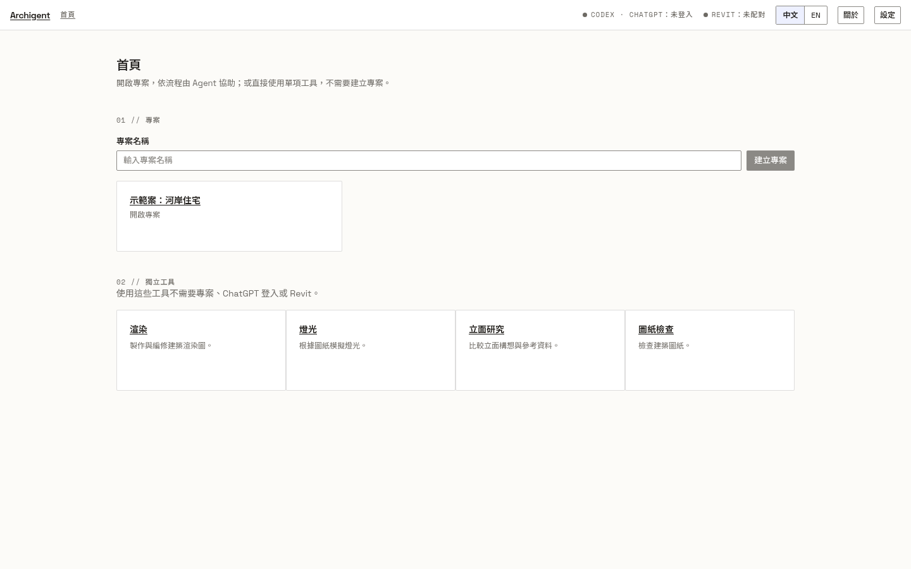

*Home: create or open a project, or use a standalone tool*

## Quick start

1. Install Archigent (section 1) and open it.
2. In **Settings > Accounts & API**, sign in to ChatGPT or paste an API key (section 1).
3. Check the Agent engine in **Settings > Agent**: Codex is the default; Claude Code and Pi are described in section 3.
4. On **Home**, create a project and open a stage (section 2).
5. Select **Start Agent**, choose a suggested step or type a request, and select **Send**.
6. Read every approval card before you approve it (section 4).

## 1. First start and providers

Open the desktop app, or ask your administrator for the local web address. Use the header language switch for English or Traditional Chinese. Open **Settings**. For a ChatGPT Plus or Pro account, choose **ChatGPT > Continue with ChatGPT**; finish sign-in in the system browser on this same computer and return to the app. Check that Settings says you are signed in. Sign out there when needed. A remote or shared server cannot use this sign-in.

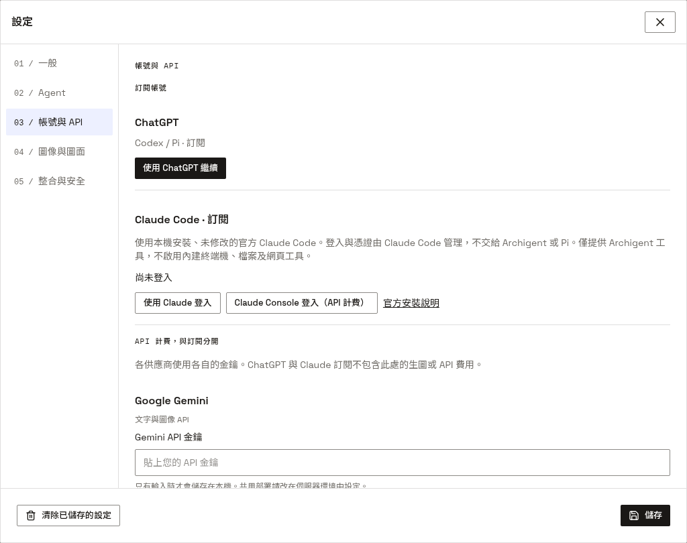

*Settings > Accounts & API: subscription sign-in and API keys*

In **Settings > Agent > Provider selection**, choose a text provider and a separate Agent provider. With the default Codex engine, the Agent accepts a ChatGPT plan, an OpenAI API key, or an OpenAI-compatible service that supports Responses; Claude Code and Pi are covered in section 3. Gemini and chat-only compatible services can serve text tasks. For a compatible service, enter its base URL, model, and key, then mark Responses support only if the service actually provides it. For **Render**, **Lighting**, or **Facade study**, enter a Gemini or OpenAI API key in Settings; ChatGPT plan use does not pay for image generation. Desktop keys use the operating system credential service. If that service is unavailable, ask the administrator to configure the server environment.

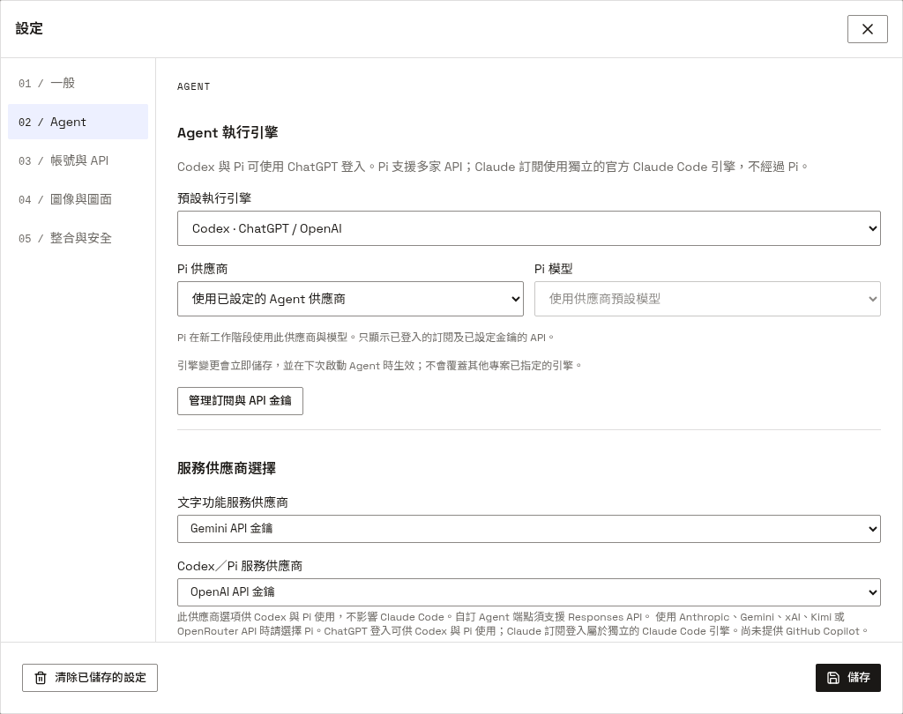

*Settings > Agent: default engine and providers*

### Install the desktop app

Download Archigent from the [Download page](https://pimiya.github.io/aixgood/en/archigent/download.html), or directly from the [latest release](https://github.com/PIMIYA/aixgood/releases/latest). Each release lists `SHA256SUMS.txt` to check the downloaded file.

#### Windows

1. Download `Archigent-Setup-<version>-x64.exe` from the Download page.
2. Run the installer and follow its steps. The Windows installer is not code-signed yet, so Windows SmartScreen may show **Windows protected your PC**. Only for a file you downloaded from the Download page or received from the project team, choose **More info > Run anyway**. If your company blocks the installer, ask your IT administrator.
3. Open **Archigent** from the Start menu.
4. Select **About** in the header and check the version against the release page.

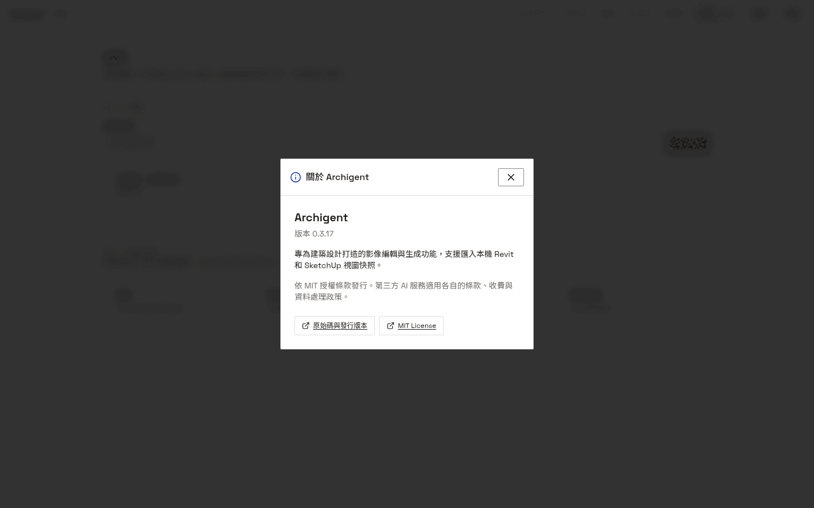

*About: check the installed version*

#### macOS

Download one ZIP from the Download page:

- `Archigent-<version>-arm64-mac.zip` for Apple Silicon Macs.
- `Archigent-<version>-universal-mac.zip` for Apple Silicon or Intel Macs.

1. Double-click the ZIP to extract **Archigent.app**.
2. Move **Archigent.app** to Applications.
3. Open the app. It is signed and notarized by Apple; on first open macOS asks whether to open an app downloaded from the internet. Choose **Open**.
4. Select **About** in the header and check the version against the release page.

Upgrading from ArchiGen Studio: the app is now named Archigent. Projects, settings and saved keys stay where they were
and appear in Archigent. On a Mac, quit the old app and delete **ArchiGen Studio.app** from Applications after
installing **Archigent.app**. On Windows, the installer replaces the old version. Reinstall the SketchUp and Revit
plug-ins from the app so their menus also show Archigent; pairing keeps working with the older plug-ins until then.

### Save keys and choose models

1. Open **Settings** in the upper-right corner and choose **Accounts & API**.
2. Under **Google Gemini** and/or **OpenAI**, paste your own API key.
3. Select **Save**. The desktop app stores the key using your operating system credential service; it is not bundled into the app or shown back to you.
4. Reopen Settings and confirm the key is marked as saved.

#### Providers and engines at a glance

Archigent uses AI services in three places: **text features** (the assistant, prompt help), the project **Agent**, and **image generation** (Render, Lighting, Facade study). Each service is either a **subscription sign-in** (ChatGPT, Claude) or an **API key** billed per use by that provider. The Agent runs on one of three engines (section 3); the table shows which provider works where.

| Provider | How you connect | Text features | Agent: Codex | Agent: Pi | Agent: Claude Code | Images |
| --- | --- | --- | --- | --- | --- | --- |
| ChatGPT Plus or Pro | Subscription sign-in: Accounts & API > ChatGPT | Yes | Yes | Yes | No | No |
| Claude subscription (personal, e.g. Pro or Max) | Subscription sign-in: Accounts & API > Claude Code > Sign in with Claude | No | No | No | Yes (preview) | No |
| Claude Console | API billing: Accounts & API > Claude Code > Claude Console sign-in | No | No | No | Yes (preview) | No |
| OpenAI | API key: Accounts & API > OpenAI | Yes | Yes | Yes | No | Yes |
| Google Gemini | API key: Accounts & API > Google Gemini | Yes | No | Yes | No | Yes |
| Anthropic (Claude models) | API key: Accounts & API > Pi provider API keys | No | No | Yes | No | No |
| xAI (Grok) | API key: Pi provider API keys | No | No | Yes | No | No |
| Kimi (Moonshot) | API key: Pi provider API keys | No | No | Yes | No | No |
| OpenRouter | API key: Pi provider API keys | No | No | Yes | No | No |
| OpenAI-compatible endpoint | Base URL, model, optional key: Accounts & API | Yes | Only with the Responses API | Yes | No | No |

Things to know

- **Subscriptions do not pay for images or API use.** A ChatGPT or Claude subscription runs the Agent, but Render, Lighting and Facade study always need a Gemini or OpenAI API key.
- **A Claude subscription works only through the Claude Code engine.** You install the official Claude Code yourself and sign in from Archigent; Archigent never sees your Claude password or tokens. Team and Enterprise Claude accounts are not accepted; use Claude Console (API billing) or Pi with an Anthropic key instead. Claude Code is not available on Windows yet, and it is a preview in this version (section 3).
- **Pi with an API key** can use Anthropic (Claude models), Google Gemini, xAI, Kimi, OpenRouter, OpenAI or a compatible endpoint, each billed by that provider. Anthropic, xAI, Kimi and OpenRouter keys go in **Pi provider API keys** (desktop app; stored with the operating system's credential service); Gemini and OpenAI keys use their own fields. In **Settings > Agent**, choose the **Pi provider** and **Pi model**; only providers you have signed in to or saved a key for are listed. The models offered per provider: Anthropic claude-sonnet-4-5, claude-opus-4-6; Gemini gemini-3.1-pro-preview, gemini-2.5-flash; xAI grok-4.7; Kimi kimi-k3.1-pro; OpenRouter openai/gpt-5.6-terra, google/gemini-3.1-pro-preview; OpenAI gpt-5.6-terra, gpt-5.6-sol, gpt-6-sol; ChatGPT plan gpt-5.6-terra, gpt-5.6-sol.
- **Codex** accepts only the ChatGPT plan, an OpenAI key or a compatible endpoint that supports the Responses API. Providers marked **— Pi** in the provider list need the Pi engine.
- GitHub Copilot is not available.

#### Text and Agent providers

In **Settings > Agent**, **Default engine** chooses Codex (ChatGPT plan or OpenAI), Pi (several API providers) or Claude Code (a Claude subscription through the official Claude Code installed on this computer). Under **Provider selection**, choose the provider for text features and for the Agent separately. Text features support **Use your ChatGPT plan**, OpenAI key, Gemini key and an OpenAI-compatible endpoint. The Agent supports the ChatGPT plan, OpenAI key and compatible endpoints that support the Responses API. Sign in in the ChatGPT section first to use the plan. Gemini and chat-only endpoints cannot run the Agent. For a compatible endpoint, enter the base URL and model, then optionally an API key. The key field shows **Saved key** without revealing the key; use **Replace** or **Clear key** and Save. The URL must use HTTPS, except HTTP to a literal loopback address such as `127.0.0.1`. Image generation still uses the Gemini or OpenAI settings below.

#### Gemini models

The image-model list in **Settings > Images & drawings** is fetched from your Gemini account when Settings opens. Select **Refresh models** to retrieve the latest available models. A fallback list does not guarantee that a model is enabled for your account, region, or API key.

## 2. Create a project and use the Agent

### Create and open a project

1. On **Home**, type a project name under **Project name** and select **Create project**. Existing projects are listed below; select one to open it.
2. The project opens on its first stage. The left column lists the seven stages (Sketch, CAD, Model, Sheets, Quantities and cost, Render, Lighting). A stage status is only a guide; you can open any stage at any time.
3. The centre shows the stage's files or tool. The right column is the **Agent panel**, with the tabs **Agent** and **Quick question**.

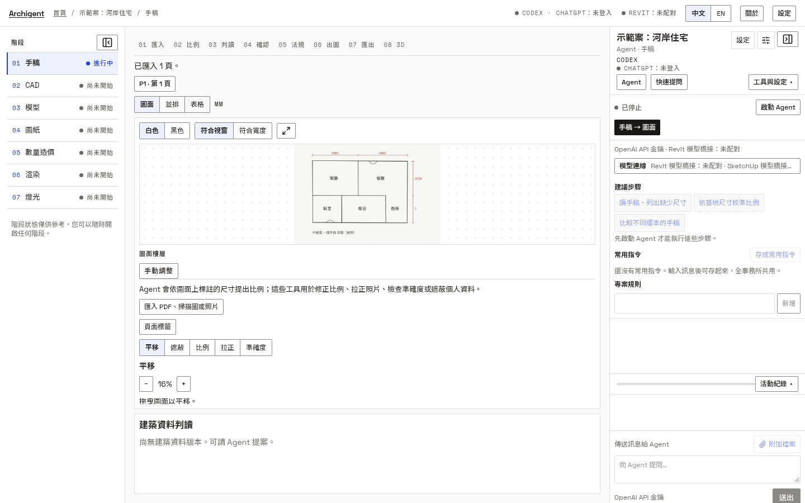

*Project workbench: stages on the left, the current stage in the centre, the Agent panel on the right*

### Run the Agent

1. Check the engine and account at the top of the Agent panel (for example `CODEX · CHATGPT：已登入`). To use another engine, see section 3.
2. Select **Start Agent**. On first use the engine is downloaded and verified; wait for the progress indicator.
3. Select one of the **Suggested steps** to put a request in the message box, or type your own. Suggestions never send by themselves. Edit the text, then select **Send**.
4. Watch the plan and the **Activity log**. When the Agent needs your decision, an approval card or a question appears in the panel (see section 4).
5. **Interrupt** stops the current turn; **Stop** ends the Agent session. The Agent also stops by itself after 15 minutes without activity.

Every turn, the Agent receives the current stage's guidance, your project rules and the project settings.

### Agent controls

Select the sliders button (**Agent controls**) at the top of the Agent panel to show these controls:

- **Agent engine**: the engine this project uses (change it in Settings, see section 3).
- **Model** and **Reasoning effort**: available after the Agent starts. A compatible endpoint fixes the model.
- **Auto mode**: **Ask every time** (default); **Auto: low risk** approves creating and editing the Agent's own Revit and SketchUp elements without a card; **Auto: full** also approves exports and project rules. Custom C# or Ruby, ArchiLAW queries, paid image generation, deletion and Codex commands outside its sandbox always ask. At most 20 actions per turn are approved automatically, and each appears in the activity log as *Auto-approved*.
- **Plan first**: the Agent proposes a plan without changing anything; select **Run the plan** to carry it out.
- **Conversation**: earlier conversations of this engine (the most recent one continues when the Agent starts) and **+ New conversation**. An older conversation started with earlier tools shows a notice to start a new one.

### Attach files, saved prompts and notifications

- **Attach** (or drop files on the message box) adds PNG, JPEG or PDF files, up to 15 MB each and 10 per message, to the project folder. Images are sent to the model only when the project allows unmasked sending, and each such send is recorded; PDFs are referred to by name only.
- **Saved prompts** are shared by the whole office: type a message and choose **Save message as prompt**; click a prompt to insert it.
- **Settings > General > Notifications** shows a desktop notification when the Agent finishes or needs approval while Archigent is in the background. It never includes message content.

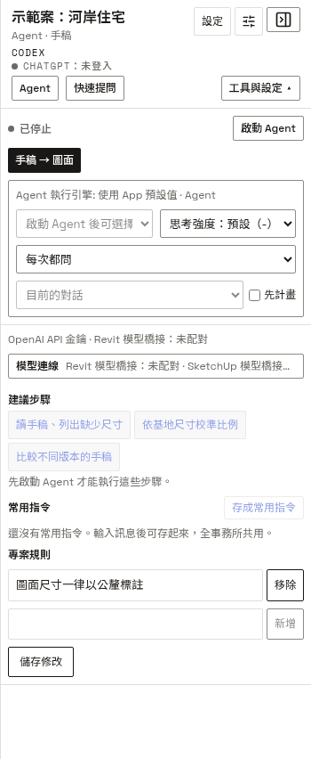

*Agent panel with Agent controls open: engine, model, reasoning effort, auto mode, conversation, Plan first and project rules*

### Arrange the workspace

To give the centre more room, collapse the stage list with the button beside **Stages** and the Agent panel with the button at its top right. The collapsed stage rail keeps numbered links to every stage. The Agent keeps working while collapsed; when it waits for your approval, the collapsed rail shows the count and a notice appears. Drag the Agent panel's left edge to make it wider or narrower (double-click the edge to reset). The app remembers these choices. **Settings > General > Appearance** switches between **Match system**, **Light**, and **Dark**.

### What to ask in each stage

| Stage | What to ask and check |
| --- | --- |
| Sketch | Inventory versions, find missing dimensions, calibrate against known site dimensions; confirm assumptions and the chosen sketch. |
| CAD | Draft millimetre-scale layers and dimensions, export DWG/DXF and PDF, compare against sketch; review inferred dimensions and layer names. |
| Model | Read the paired Revit or SketchUp model, report the architect's intervening edits, propose a versioned change; approve each write only after checking revision and affected elements. In SketchUp a batch is one undo step and is undone completely on any failure. |
| Sheets | List required sheets, export and check every sheet for overlaps, text outside the frame, and Simplified characters; review title blocks and numbering. |
| Quantities and cost | Request quantities with source references, independent recomputation and a difference report; check each unit-price source and flagged AI estimates. |
| Render | State what must stay, site conditions, and design freedom; compare the generated view and alignment score. |
| Lighting | Read the plan and fixture schedule, review positions and editable regions, compare schemes. |

Sketch, CAD, Model, and Quantities currently show guidance rather than dedicated editing panels. The Agent can work in its project workspace; Revit and SketchUp work needs a paired plug-in (pair it in the Model stage) and explicit approvals. CAD export and cost conclusions require architect review.

## 3. Choose an Agent engine: Codex, Claude Code or Pi

The project Agent can run on one of three engines. All three use the same Archigent tools (project files, sketch and CAD tools, ArchiLAW, Revit and SketchUp), the same approval cards and the same project rules. They differ in which accounts they can use, how they are installed and how they are protected.

|  | Codex (default | Claude Code | Pi |
| --- | --- | --- | --- |
| Accounts | ChatGPT plan, OpenAI API key, OpenAI-compatible endpoint with the Responses API | Your own Claude subscription, or Claude Console (API billing) | ChatGPT plan, OpenAI, Anthropic (Claude models, API billing), Google Gemini, xAI, Kimi, OpenRouter, compatible endpoint |
| Installation | Downloaded and verified automatically on first start | You install the official Claude Code yourself (version 2.1.319 or later in 2.1) | Downloaded and verified automatically on first use (about 25 MB) |
| Tools | Archigent tools, plus its own commands and file edits in a sandbox, each approved by you | Archigent tools only; its own terminal, file and web tools are turned off | Archigent tools only |
| Protection | Operating-system sandbox, no network for commands | Restricted tool set; no operating-system sandbox | Runs inside the same sandbox as Codex |
| macOS | Yes | Preview | Yes |
| Windows | Yes; full protection after the one-time security setup | Not available yet | Only after the one-time security setup |
| Models | From your account after start | sonnet (default), opus, fable | A fixed list per provider, chosen in Settings |

Which one to use: start with **Codex** if you have a ChatGPT Plus or Pro plan or an OpenAI key. Use **Claude Code** if you have a personal Claude subscription and work on a Mac; it is a preview (see below). Use **Pi** for an Anthropic, Gemini, xAI, Kimi or OpenRouter API key. A Claude subscription is used only through Claude Code; Pi with Anthropic is billed per API use. GitHub Copilot is not available.

### Switch the engine

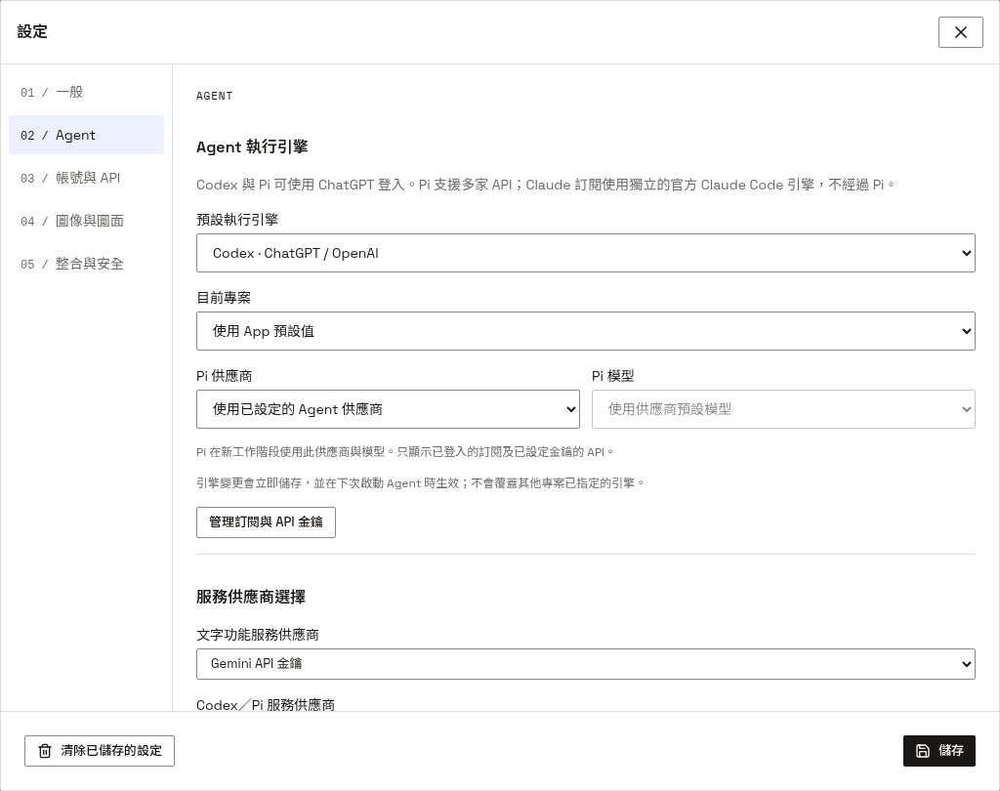

*Settings > Agent: the default engine, the current project's engine, and the Pi provider and model*

There are two levels. **Default engine** applies to every project that has no choice of its own. **This project** (shown only while a project is open) overrides the default for that project.

1. Open a project if you want to change only that project, then select **Settings** in the header and choose **Agent**.
2. Under **Agent engine**, choose **Default engine**, or **This project**. Choose **Use the app default** to remove a project's own choice.
3. The choice is saved immediately; there is no Save button. It takes effect the next time the Agent starts.
4. To change **This project**, first select **Stop** in that project's Agent panel. The selection is locked while that project's Agent is running. The default engine can be changed at any time; a running Agent keeps its engine until it is stopped.
5. Changing a project's engine resets that project's **Model** and **Reasoning effort** to their defaults.
6. Select **Start Agent**. Check the engine name at the top of the Agent panel (for example `CODEX · CHATGPT：已登入`, `CLAUDE CODE · 訂閱已連線` or `PI · ANTHROPIC API 金鑰 · CLAUDE-SONNET-4-5`).

An engine that cannot run on this computer is shown but cannot be chosen: Claude Code shows **Setup required** until it is installed and signed in; Pi shows **unavailable on this device** when this computer cannot run it.

### Conversations when you switch

Each engine keeps its own conversations. Switching does not convert or delete them: conversations made with Codex appear again when you switch back to Codex. When the Agent starts, it continues the engine's most recent conversation; choose **+ New conversation** in the Agent controls to start fresh. After 15 minutes without activity the Agent stops by itself; start it again to continue.

### Set up Codex

1. Open **Settings > Accounts & API**. For a ChatGPT plan, select **Continue with ChatGPT** under **ChatGPT**, finish sign-in in the browser on this computer, and return to Archigent. For an OpenAI key, paste it under **OpenAI**.
2. In **Settings > Agent**, set **Codex / Pi provider** to **Use your ChatGPT plan**, **OpenAI API key** or **OpenAI-compatible endpoint**. A compatible endpoint can be chosen only when **Supports the Responses API** is ticked in Accounts & API.
3. Select **Start Agent**. The first start downloads and verifies Codex (**Downloading Agent runtime**, then **Verifying Agent runtime**).

If the panel says **Sign in with ChatGPT in Settings to use this agent provider**, use **Open Settings** and sign in. The Anthropic, Gemini, xAI, Kimi and OpenRouter choices in the provider list are marked **— Pi** and work only with the Pi engine; with Codex the Agent does not start.

### Set up Claude Code

Claude Code is a preview in this version: signed-in use in the installed desktop app has not been fully verified yet. If something does not work, switch the project back to Codex and report the problem with the steps you took.

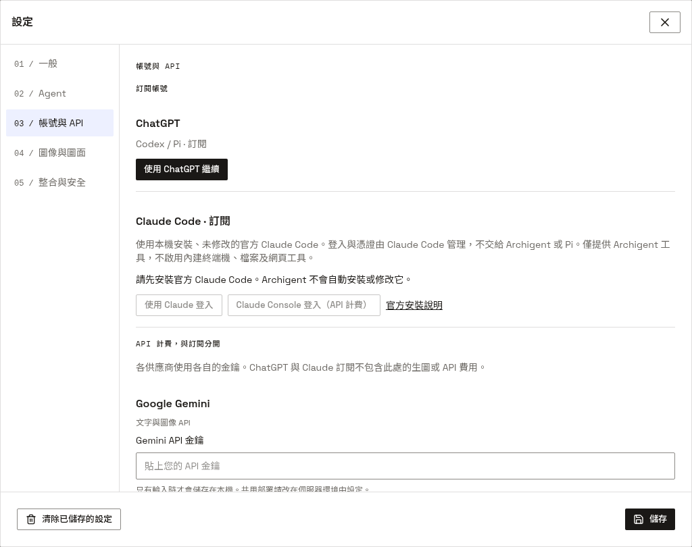

*Settings > Accounts & API: the Claude Code card before installation*

1. Install the official Claude Code on this computer (**Official installation instructions** opens Anthropic's setup page). Archigent does not install or change it. Version 2.1.319 or later in the 2.1 series is required; an older version shows **Update official Claude Code**.
2. In **Settings > Accounts & API**, under **Claude Code · Subscription**, select **Sign in with Claude** for your subscription, or **Claude Console sign-in (API billing)** for API billing. Complete the official sign-in in the browser, then return to Archigent. The card shows **Subscription connected** or **Claude Console connected · API billing, not subscription**. Archigent keeps its own Claude Code settings folder, so sign in here even if you already use Claude Code in a terminal.
3. In **Settings > Agent**, choose **Claude Code · Subscription** as the default or for this project, then start the Agent. Choose the model (sonnet, opus or fable) and the reasoning effort after it starts.

Sign-in and credentials stay with Claude Code; Archigent never reads them. Stop every Claude Code Agent before signing in, signing out or switching between subscription and API billing. If your company manages Claude Code with policies, the engine is turned off to protect the project (**Managed Claude policies were detected**). Claude Code is not available on Windows yet; Claude models remain available there through Pi with an Anthropic API key.

### Set up Pi

1. Add the account Pi will use. ChatGPT plan: sign in under **Settings > Accounts & API > ChatGPT**. OpenAI or Gemini: paste the key in its existing field. Anthropic, xAI, Kimi or OpenRouter: in the desktop app, enter the key under **Pi provider API keys**; it is stored with the operating system's credential service.
2. In **Settings > Agent**, choose **Pi · Multiple providers** as the default or for this project.
3. Choose the **Pi provider** and **Pi model**. Only providers you have signed in to or saved a key for are listed. **Use the configured Agent provider** follows the **Codex / Pi provider** setting; **Use the provider default** takes the first model of that provider. These two settings apply to every project and are used the next time the Agent starts.
4. Select **Start Agent**. The first use downloads and verifies Pi (about 25 MB). Reasoning effort (low, medium, high) is offered only for models that support it.

On Windows, Pi becomes available after the one-time security setup (see "Windows notes" below). If the Agent does not start, check that the chosen Pi provider shows **API key configured**, or choose another provider.

### Windows notes

Codex runs on Windows after you either complete the one-time security setup or accept limited protection (**Windows Agent protection is limited** card, **I understand the risks — continue**). For full protection, open **Settings > Integrations & security**, select **Set up or repair security** and approve the administrator prompt. When it is verified, the elevated sandbox and Pi become available, and one project Agent can run at a time on that computer. Claude Code is not offered on Windows yet.

### Engine troubleshooting

| Symptom | What to do |
| --- | --- |
| The engine choice is greyed out | Claude Code: install it, sign in, and check its version. Pi on Windows: complete the security setup. |
| **Could not save the engine choice** | Stop this project's Agent, then choose again. |
| The Agent does not start after choosing Anthropic, Gemini, xAI, Kimi or OpenRouter | These providers work only with Pi; switch the engine to Pi. |
| Claude Code shows **Not signed in** or **A personal Claude subscription sign-in is required** | Sign in again under Accounts & API with a personal subscription, or choose Claude Console for API billing. |
| The model list is empty | Models are listed after the Agent starts. |
| An older conversation shows a notice about earlier tools | Start a new conversation to use the tools added since then. |

## 4. Approvals, rules, and project settings

An approval card shows the proposed command, file change, external lookup, or model action. Read its exact arguments and affected files, then choose **Approve** or **Decline**. Decline and ask for a narrower action if anything is unclear. An ArchiLAW lookup shows its query or document ID. A Revit code run must show the full C# source and hash. Broad permission grants cannot be accepted through a single action card. Do not approve sending client names, contact details, or case details to an external service.

In **Project rules**, add, edit, or remove short directives; save edits to existing rules. An Agent-proposed rule needs your approval before it is stored. Use the **Settings** button at the top of the Agent panel (beside the project name) for **Project settings**: optional design standard, family library path, and title-block rectangle. Title-block values are percentages of a sheet. The default is masked drawing sends. **Send drawings unmasked** is a project choice recorded with every send; review the outgoing pages separately even when it is enabled.

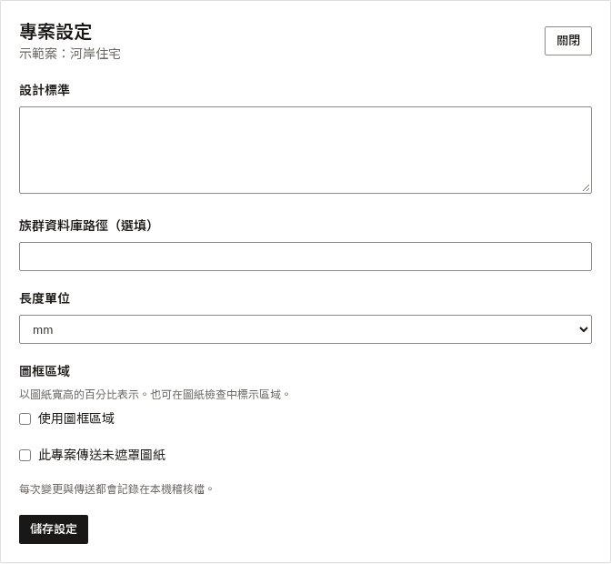

*Project settings (Settings button at the top of the Agent panel)*

## 5. Standalone tools

### Render an image

1. From Home, open **Render**, or select a project's **Render** stage, then upload a base image.
2. Enter the overall architectural prompt.
3. Optionally add regions, paint only the areas to edit, and give each region a specific instruction.
4. Choose Gemini or OpenAI as the provider.
5. Select **Generate Render**.
6. Review the result. Use **Use as Base Image** only when you want the result to replace the current canvas image.

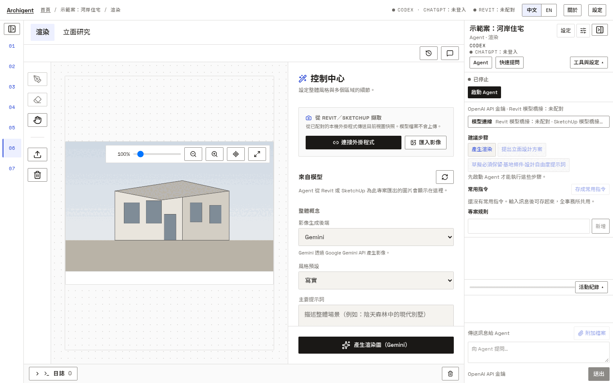

*Render with a base image on the canvas; Capture from Revit / SketchUp is in the Control Center*

### Study a facade

1. From Home, open **Facade study**. In a project, open the **Render** stage and select the **Facade study** tab.
2. Add one view of the existing building and 2 to 5 reference project images. Images must be PNG, JPEG or WebP, at most 20 MiB each, 8192 pixels per side, and 35 MiB combined.
3. Optionally enter site conditions and a design standard. Choose Gemini or OpenAI and 1 to 3 alternatives.
4. Select **Review before send**. Check the exact images and instruction. Gemini uses all references; OpenAI uses the first two and tells you how many others are omitted. Press **Send** to start generation with the provider API key.
5. Compare each result with the base view. Scores of 0.35 or higher are **Valid alternative**. Scores from 0.25 to below 0.35 show **Check the massing**: review the camera, massing, storeys and openings, then click **I confirm the massing for use and saving** to allow saving and **Use as base image in Render**. The warning label stays after confirmation. Scores below 0.25 show **Massing changed** and cannot be used or saved. In a project, valid alternatives are saved to its local timeline automatically; results marked **Check the massing** are saved only after your confirmation.

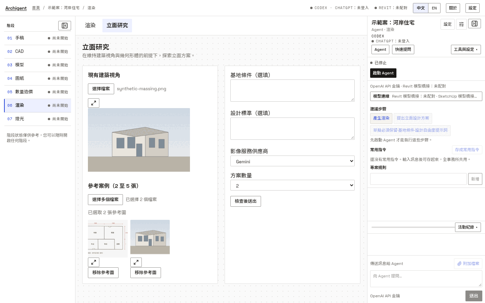

*Facade study with an existing view and two references chosen*

### Develop a lighting scheme

1. From Home, open **Standalone tools > Lighting**, or choose **Lighting** in a project workbench, then load the viewpoint render into the canvas.
2. Open the drawing set PDF. Choose the ceiling plan (天花) and, if the space has floor lamps or wall lights, the floor plan (地坪).
3. In the **Plan** tab, for each sheet: drag a crop around the area the render shows, leaving out the title block and legend, select **Confirm crop**, then switch to **Camera**, click where the camera stands and drag towards where it looks. Use the same position on both sheets.
4. Optionally import the fixture schedule (燈具表). If it spans several sheets, import each one; rows are combined by code. It is read on this computer only. Check the brand and model columns; **Look up** searches the web for missing data after you confirm the exact brand/model pairs, and saves the result for later projects.
5. Choose the scene and, optionally, add notes.
6. Select **Review and generate**. Check the images and the instruction text, then select **Send**. Nothing is sent before that.

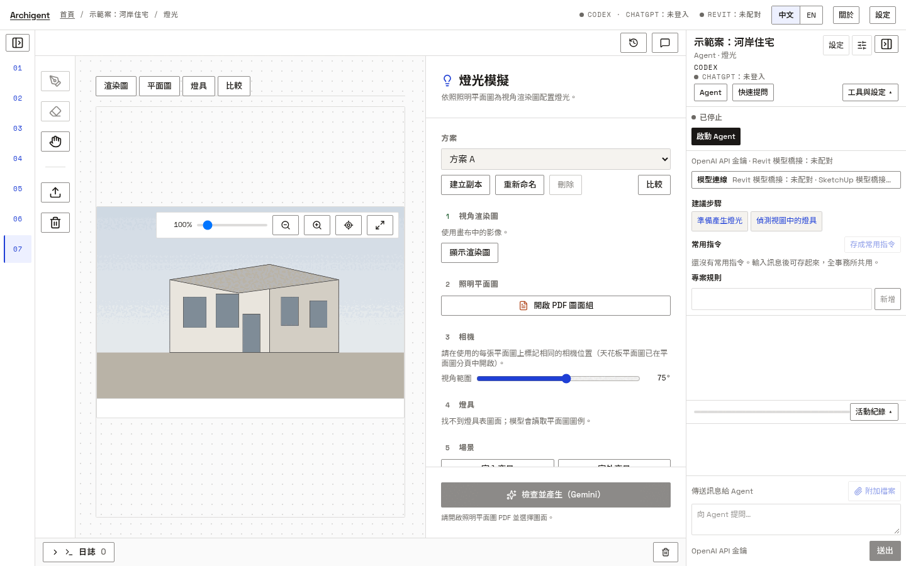

*Lighting: schemes and the six steps from viewpoint render to scene*

By default the result preserves the structure of your render and transfers the lighting from the AI image (**Settings > Images & drawings > Lighting > Output: Lighting transfer**). If the model changed the space too much to match your render, the result is rejected and your render is unchanged; generate again. The other option, *AI image*, shows the model's image as is and warns when the space changed.

Compare lighting schemes:
1. After the crop is confirmed and the camera is aimed, the fixtures in view are placed on the plan automatically. The panel shows how many; labels whose fixture variant is unclear are counted so you can add them yourself.
2. In the **Plan** tab, choose **Fixtures** to move, add (pick the code first), disable or delete markers. Changing the view moves the automatic markers until you edit one.
3. Use **New copy** in the scheme control to try another arrangement, then generate each scheme. The **Compare** tab shows the latest result of every scheme side by side.

Change the lighting in one area: select **Use as Base Image** on a result, paint a region on the **Render** tab, write what should change in the **Region edits** step, and generate with Gemini. Only the painted area changes; OpenAI lighting region edits are refused before sending. To let the AI draw fixture bodies (for example track spotlights) in a painted area, turn on **Settings > Images & drawings > Lighting > Show fixture bodies in painted regions** and set that region to **Fixture body**.

Fixture library: in the **Fixtures** tab choose **Fixture library** to search by brand, model or type, add or edit fixtures by hand, look one up online, or assign it to a fixture code with **Add to project**.

The result is a visual simulation, not a lighting calculation (no lux values). Use DIALux or Relux for calculations. Daylight already in the render (sun patches) stays faintly visible after a night transfer; a render without direct sunlight works best.

### Ask the Agent to render or check workspace files

For files already in the project workspace, ask the Agent to render a PNG/JPEG view, study a facade
with 2–5 reference images and 1–3 alternatives, or check PDF sheets locally. Image tools use Gemini
by default; you can ask for OpenAI (facade studies allow only two references with OpenAI). Agent
image tools use server-configured keys or desktop keys, not browser-only personal overrides.

Before approving, inspect every image preview, its path and dimensions, the full instruction,
provider/model and number of paid outputs. These tools send views as shown without masking title
blocks; decline if a view exposes private drawing information. PDFs cannot be sent through render
or facade tools. If a source changes while you review, request a new review. Declining makes no
provider request and saves no result.

Results appear under `renders/` or `facade/` with an alignment score. At 0.35 or above the level is
`valid`; 0.25 to below 0.35 means `check` (check the massing); below 0.25 means `changed` (massing
changed), and the saved filename includes `massing-changed`. Review the building geometry before
using the image. Lighting is not an Agent tool: its UI needs plan crops and a camera drawn on the plan.

Agent `sheet_check` reads PDFs locally for Simplified characters, overlapping text and text outside
the detected frame. It has no AI visual check and does not automatically complete a stage. Pages
without a text layer or detected frame need manual review in Sheet check.

### Check sheets

**Sheet check:** Import PDF, PNG, or JPG sheets. PDF text checks run locally for Simplified Chinese, overlapping text, and text outside the detected or manually drawn frame. Image-only pages have no local text check. Export findings as Markdown or CSV. For an optional visual check, draw the title-block region, select **Review before send**, inspect each masked page and instruction, then confirm the send. In a project, use the unmasked switch only after reviewing what it reveals. A Sheet check does not automatically mark the stage done.

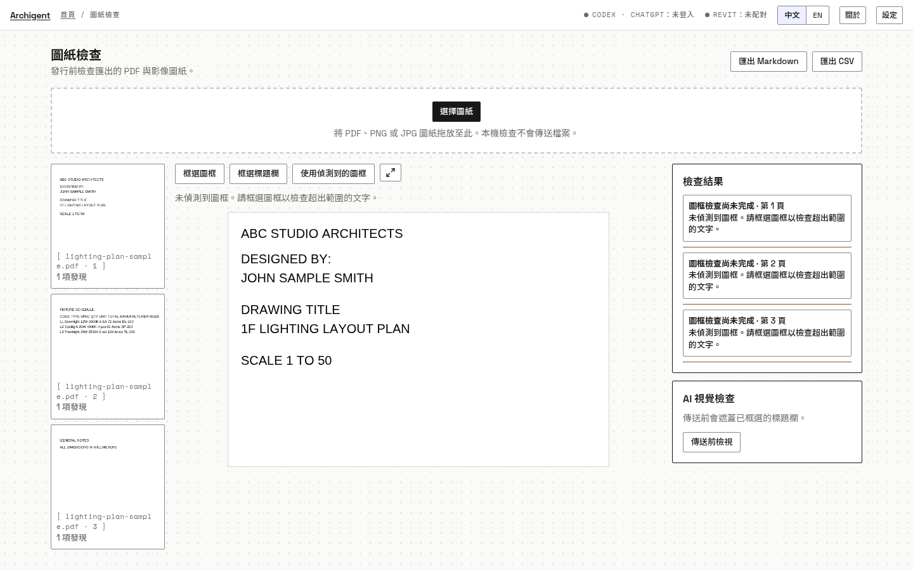

*Sheet check with a sample PDF: pages, frame tools and findings*

## 6. ArchiLAW and Revit

For regulation research, enter the administrator's HTTPS MCP URL under **Settings > Integrations & security > ArchiLAW**, save it, and select **Connect**. Sign in with your own invited account on this computer. After the status shows connected, restart the Agent and ask a question. Inspect the exact proposed query and optional jurisdiction or document ID before approval; remove personal and case details. Check the cited sources in the answer. **Disconnect** removes local credentials; a blank saved URL disables the endpoint.

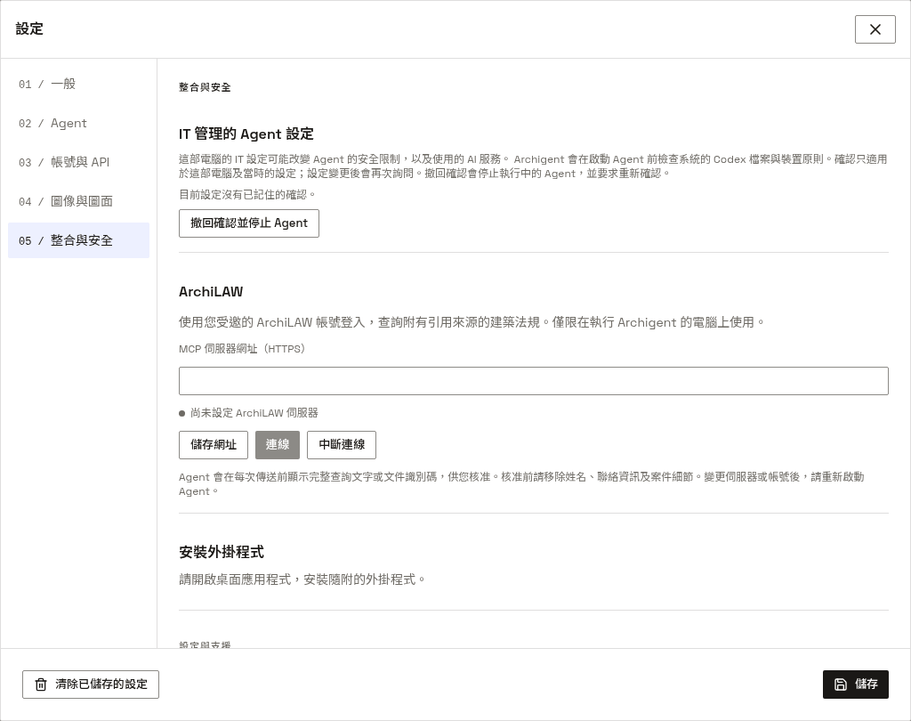

*Settings > Integrations & security: ArchiLAW connection*

For a viewport image, install the matching Revit or SketchUp companion, open **Capture from Revit / SketchUp > Connect companion**, and enter the local endpoint and temporary token in the companion. Capture the current view in the host app. In Archigent, inspect the thumbnail and choose **Use in canvas** or **Discard**; capture never replaces the canvas automatically. Keep the pairing token out of screenshots. Revit model pairing for Agent actions is separate from viewport capture. An administrator must install the Revit 2025/2026 add-in and pair the selected project. Revit writes save a version and use a ledger of Agent-created elements; architect edits must be reported before another write. The bridge has not yet been verified in Revit on Windows.

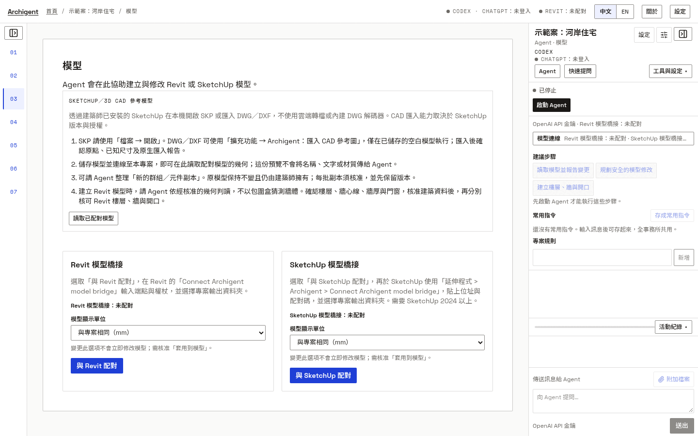

*Model stage: Revit and SketchUp model bridges before pairing. After you pair, the endpoint and token appear here; keep them out of screenshots.*

### Capture a viewport image

Use this optional workflow to send a raster snapshot of the current host-application viewport into Archigent. Archigent does not upload, open, or store RVT/SKP model files.

1. Install the matching companion before starting this workflow; Archigent cannot auto-discover Revit or SketchUp, and it cannot capture another application's window directly. SketchUp (macOS/Windows): install `ArchiGen-SketchUp-<version>.rbz` with **Extensions → Extension Manager → Install Extension**. Revit 2025/2026 (Windows): extract `ArchiGen-Revit<year>-<version>.zip` and run `install.ps1`. The desktop app carries the installers: download them from the **Install the plug-in** links in this panel or in the Model stage.
2. In the Control Center, open **Capture from Revit / SketchUp** and select **Connect companion**.
3. Copy the endpoint and pairing token shown in the panel into the companion (each **Copy** button, or **Copy both** and then **Paste from clipboard** in Revit). Do not include either value in screenshots or support requests.
4. In SketchUp, use **Extensions → Archigent → Capture current view to Archigent**. In Revit on Windows, run **Capture current view to Archigent** from the installed add-in.
5. Return to Archigent and review the thumbnail, source application, document display name, and dimensions.
6. Select **Use in canvas** to replace the current base image, or select the trash button to **Discard** the received snapshot. A capture never replaces the canvas automatically.

#### Supported platforms and fallback

- The SketchUp companion is intended for macOS and Windows. The Revit companion is Windows-only because Revit is Windows-only.
- Pairing is local to the same computer and accepts PNG/JPEG snapshots only. Use a new token within five minutes; after the first capture it stays valid until 12 hours after the last capture. Connect again after restarting Archigent, because its local address changes.
- If a companion is unavailable, pairing expires, or a host version is unsupported, export the current view as PNG/JPEG in Revit or SketchUp and use the ordinary **Import image** button in Archigent.
- Installation instructions for testers are in `integrations/README.md`.

### Chat and documents

The **Assistant** (speech-bubble icon in the Render and Lighting workspace) is for quick design questions and prompt ideas. It answers only and changes nothing; it uses the current main prompt, approved project memories and matching uploaded reference documents, and it works without a project, a ChatGPT sign-in or Revit, with Gemini or OpenAI (Settings > Text provider). When a reply suggests a prompt, choose **Apply to prompt** to put it in the canvas prompt field. In a project, the **Agent** is the main assistant: it can also search the same reference documents and approved memories, and it can act with your approval. The Agent panel's **Quick question** tab opens the same lightweight assistant. Projects, chat history and memories are kept in the local database.

## 7. Files and troubleshooting

The desktop app keeps private application data in its operating system user-data folder; the local web server defaults to `~/.archigen-studio` unless `ARCHIGEN_DATA_DIR` is set. Project records, chat, and documents are in `archigen.sqlite`; Agent workspace files are under `projects/<id>/workspace/`. Rules and settings are stored per project. Browser canvas timelines and some web settings stay in that browser. Exported images, Markdown/CSV findings, and CAD/Revit files go to the location you choose or to the host application's file location; an Agent workspace file is not automatically copied into Revit or CAD. Back up your source drawings separately.

If **Start Agent** fails, check the selected Agent provider and sign-in status, then its download/error message; the first download needs network access. If image generation is unavailable, check the Gemini/OpenAI key, selected model, and Settings status; ChatGPT sign-in alone is insufficient. If a visual Sheet check cannot send, draw a title-block rectangle and review the masked pages, or explicitly enable and review unmasked sending for that project. If Revit pairing fails, ensure Archigent and Revit run on the same computer, repeat pairing before the five-minute token expires, and use the add-in matching the Revit year. For an ArchiLAW failure, check the HTTPS URL, sign-in status, and approval; reconnect and restart the Agent after an account change. Report errors without sending credentials, pairing tokens, client names, or private drawings in screenshots.

### Common errors

| Issue | What to do |
| --- | --- |
| Gemini model list shows a fallback | Confirm the key is saved, select **Refresh models**, then check that your key, account, region, and network can access Gemini. |
| `401` or `403` provider error | The key is invalid, unavailable, or lacks permission. Replace it in Settings. |
| `429` provider error | The provider quota or rate limit was reached. Wait, choose another available model, or check your provider account. |
| Image result is unexpected | Retry with one clear scene description, fewer reference images, and painted masks only where editing is required. |
| The app cannot generate after an update | Quit the app completely, reopen it, and confirm the saved key in Settings. |
| A companion capture does not arrive | Confirm Archigent is running on the same computer, pair again, and copy the current local endpoint and token into the host extension. |
| A companion capture is rejected | The pairing may have expired, the image may be too large, or the request is not a PNG/JPEG snapshot. Pair again or use manual PNG/JPEG import. |

### Report an issue

- Never send API keys, viewport pairing tokens, or captured model-file paths in screenshots, chat messages, issue reports, or email.
- Use the bottom **Logs** panel when reporting an error. Copy the redacted error message and the steps that caused it; do not include keys or pairing tokens.
- Report the app version, operating system version, selected provider/model, and whether a mask or reference image was used.
